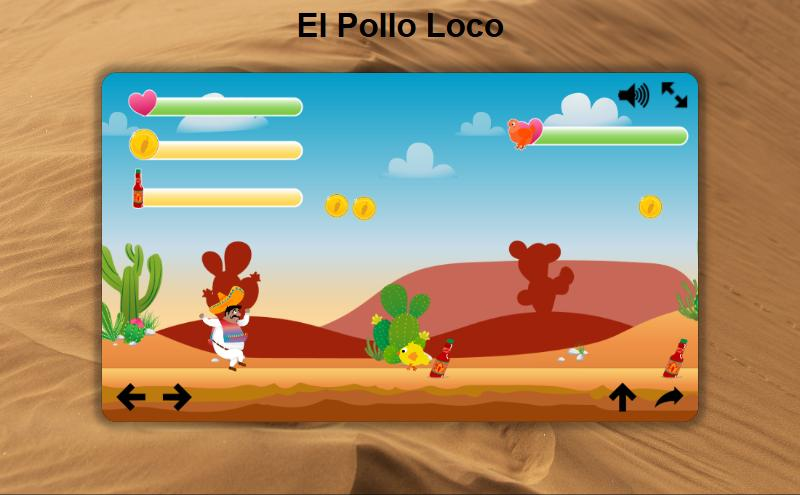

# El Pollo Loco – 2D-Jump-and-Run

> **Bootcamp-Projekt**

**Live-Demo:** https://curiosoofficial.github.io/ell-pollo-loco-final/



Ein 2D-Browserspiel, objektorientiert in reinem JavaScript. Pepe läuft durch die Wüste, springt auf Hühner, sammelt Münzen und Salsa-Flaschen und besiegt am Ende das Riesenhuhn, indem er die Flaschen wirft.

## Steuerung

| Taste | Aktion |
| --- | --- |
| ← / → | Laufen |
| Leertaste | Springen (auf Hühner springen besiegt sie) |
| A | Salsa-Flasche werfen (nur gegen den Endboss wirksam) |

Auf dem Smartphone gibt es Touch-Buttons im Querformat. Ton und Vollbild lassen sich oben rechts im Spiel umschalten.

## Technik

- Reines JavaScript mit **Klassen und Vererbung**: `DrawableObject` → `MovableObject` → `Character`, `NormalChicken`, `SmallChicken`, `Endboss`, `ThrowableObject` usw.
- Rendering auf dem **HTML5-Canvas** mit `requestAnimationFrame`, Kamera über `ctx.translate`
- Spiellogik in `setInterval`-Schleifen: Schwerkraft, Sprite-Animationen, Kollisionsprüfung
- Kollisionserkennung mit Bounding Boxes und Offsets pro Objekt
- Sounds über die `Audio`-API
- Grafiken aus dem Kursmaterial

## Überarbeitung 2026

- Fehler behoben: Nach jedem «Restart Game» lief die Zeichenschleife (`requestAnimationFrame`) der alten Spielwelt im Hintergrund weiter. Nach drei Neustarts zeichneten vier Welten gleichzeitig. Jetzt wird die alte Schleife mit `cancelAnimationFrame` gestoppt.
- Falschen relativen Bildpfad im Game-over-Screen korrigiert (404)
- Verweis auf ein nie eingechecktes Stylesheet (`fonts.css`) entfernt (404)
- Tippfehler und ungültige `charset`-Angabe korrigiert

## Lokal starten

Am einfachsten mit einem lokalen Webserver:

```bash
npx serve .
```

oder

```bash
python -m http.server 8000
```

Danach `http://localhost:3000` bzw. `http://localhost:8000` öffnen. Alternativ funktioniert die VS-Code-Erweiterung «Live Server».
